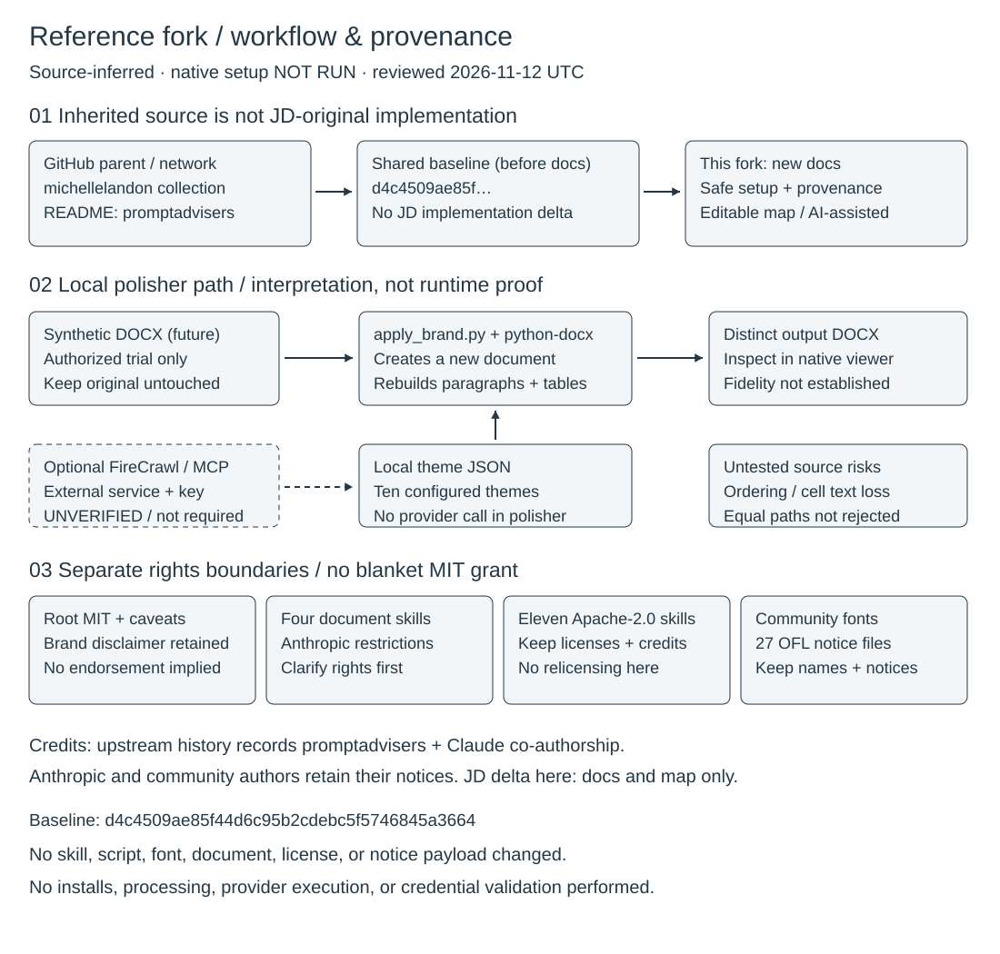

# Claude Code Skills Collection

> **Reference fork — inherited document skills with a documented provenance and safety review.**

This is a reference/learning fork of [michellelandon's collection](https://github.com/michellelandon/claude-code-polished-documents-skills), also linked by the inherited documentation as [promptadvisers' collection](https://github.com/promptadvisers/claude-code-polished-documents-skills). Before this documentation cleanup, all three default heads resolved to [`d4c4509`](https://github.com/JDKristenson/claude-code-polished-documents-skills/commit/d4c4509ae85f44d6c95b2cdebc5f5746845a3664) on 2026-11-12. No JD-specific implementation delta was evidenced at that baseline. This cleanup adds documentation and an original editable map, not authorship of the inherited skills.

**Read [provenance, license boundaries, and safe setup](docs/REFERENCE-AND-SAFETY.md) first.** This is not a uniformly MIT-licensed bundle. Four document skills contain restrictive Anthropic terms; copying everything globally is not a recommended setup. All native setup, document processing, and provider behavior described below are **NOT RUN** in this review. Inherited feature descriptions are not verified guarantees.

[Workflow preview](docs/portfolio-workflow.svg) · [Editable Excalidraw source](docs/portfolio-workflow.excalidraw)



A comprehensive collection of Claude Code skills for document generation, styling, and manipulation. Includes the **Document Polisher** skill that applies premium brand styling (McKinsey, Deloitte, Stripe, Apple, and more) to your documents, plus essential skills for working with DOCX, PDF, XLSX, and PPTX files.

[License boundaries: MIT / Apache-2.0 / OFL / restricted terms](docs/REFERENCE-AND-SAFETY.md#license-boundaries)


---

## New to This? Start Here!

Start with the source and license review below; automated setup is not a substitute for it.

### Review Before Setup

Use this review-only prompt before authorizing any installation:

```text
Review this reference fork's README and docs/REFERENCE-AND-SAFETY.md.
Explain the selected skill's license and dependencies first. Do not install,
copy skills, change permissions, process documents, or contact providers yet.
Do not request or display credentials. Propose a project-local plan for review.
```

### More Prompts

See the **[quick-start/](quick-start/)** folder for:
- [QUICK-START.md](quick-start/QUICK-START.md) - Step-by-step prompts for setup
- [PROMPTS.md](quick-start/PROMPTS.md) - Copy-paste prompts for every use case

---

## Features

### Document Polisher
Transform plain documents into professionally-styled reports with 10 premium brand themes:

| Category | Brands | Best For |
|----------|--------|----------|
| **Editorial** | The Economist | Reports, analysis, thought leadership |
| **Consulting** | McKinsey, Deloitte, KPMG | Strategy decks, executive summaries, audits |
| **Tech** | Stripe, Apple, IBM, Linear | API docs, developer guides, product specs |
| **Productivity** | Notion | Wikis, project plans, documentation |
| **Design** | Figma | Creative briefs, design docs, brand guidelines |

### Core Document Skills
- **docx** - Create and edit Word documents with full formatting support
- **pdf** - Generate, merge, split, and fill PDF forms
- **xlsx** - Work with spreadsheets including formulas and data analysis
- **pptx** - Create and modify PowerPoint presentations

### MCP Server Integration
- **FireCrawl MCP** - Extract brand identity from any website to create custom themes

---

## Quick Start

### 1. Clone the Repository

```bash
git clone https://github.com/JDKristenson/claude-code-polished-documents-skills.git
cd claude-code-polished-documents-skills
```

### 2. Set Up Python Environment

```bash
# Create virtual environment
python3 -m venv venv

# Activate it
source venv/bin/activate  # macOS/Linux
# or
.\venv\Scripts\activate   # Windows

# Install dependencies
pip install python-docx
```

### 3. Copy Skills to Claude Code

Review the selected skill's terms before copying anything. Prefer a project-local,
selective setup; do not copy this mixed-license bundle wholesale. See the
[setup limitations](docs/REFERENCE-AND-SAFETY.md#setup-status-not-run).
Installing `python-docx` alone does not prepare every bundled skill.

### 4. Configure Permissions

Review the example settings before copying or enabling any permissions; it is not a least-privilege policy. The following is an inherited, untested example, not an instruction to approve broad execution:

```bash
cp .claude/settings.example.json .claude/settings.local.json
```

See [docs/SETUP.md](docs/SETUP.md) for detailed configuration options.

---

## Usage

### Using Document Polisher

In Claude Code, simply ask to polish a document:

```
Polish my report.docx with the McKinsey style
```

Or use the skill directly:

```
/skill document-polisher
```

Then select from the brand menu and provide your document.

### Command Line Usage

```bash
# Activate virtual environment
source venv/bin/activate

# Apply brand styling to a document
python .claude/skills/document-polisher/scripts/apply_brand.py \
    input.docx \
    mckinsey \
    output.docx

# List available brands
python .claude/skills/document-polisher/scripts/apply_brand.py --list
```

### Available Brands

| Brand ID | Brand Name | Style |
|----------|------------|-------|
| `economist` | The Economist | Georgia serif, red accents |
| `mckinsey` | McKinsey & Company | Georgia headings, sharp blue |
| `deloitte` | Deloitte | Calibri, teal-blue accents |
| `kpmg` | KPMG | Calibri, two-tone blue |
| `stripe` | Stripe | Arial, dark blue + purple |
| `apple` | Apple | Arial, minimalist |
| `ibm` | IBM | Arial, enterprise blue |
| `notion` | Notion | Segoe UI, clean aesthetic |
| `linear` | Linear | Arial, modern purple |
| `figma` | Figma | Arial, multi-color |

---

## MCP Server Setup (FireCrawl)

The FireCrawl MCP server enables extracting brand identity from any website to create custom themes.

### Get FireCrawl API Key

1. Go to [firecrawl.dev](https://firecrawl.dev)
2. Sign up for an account
3. Navigate to API Keys section
4. Generate a new API key

### Add MCP Server to Claude Code

**Optional provider setup — not validated here.** Confirm the current package,
CLI syntax, configuration location, and environment handling in the provider's
and client's official documentation before installing anything. Use a supported
local secret store or protected environment injection. Never paste a real key
into chat, commands, screenshots, issues, or tracked files.

**Inherited configuration illustration — not a validated configuration.**
`your_api_key_here` below is a placeholder only; do not replace it in tracked files.

The inherited example names `~/.claude/mcp_servers.json`; verify the actual location and supported secret handling in current client documentation:

```json
{
  "mcpServers": {
    "firecrawl": {
      "command": "npx",
      "args": ["-y", "@anthropic/firecrawl-mcp"],
      "env": {
        "FIRECRAWL_API_KEY": "your_api_key_here"
      }
    }
  }
}
```

### Extract Brand from Website

Once configured, ask Claude Code:

```
Extract the branding from https://example.com and add it as a new brand theme
```

See [docs/MCP-SERVERS.md](docs/MCP-SERVERS.md) for complete MCP configuration guide.

---

## Repository Structure

```
claude-code-skills/
├── .claude/
│   ├── skills/
│   │   ├── document-polisher/     # Main document styling skill
│   │   │   ├── SKILL.md           # Skill instructions
│   │   │   ├── brands/            # Brand reference files
│   │   │   ├── scripts/           # Python scripts
│   │   │   └── templates/         # Brand configuration JSON
│   │   ├── docx/                  # Word document skill
│   │   ├── pdf/                   # PDF manipulation skill
│   │   ├── xlsx/                  # Spreadsheet skill
│   │   └── pptx/                  # PowerPoint skill
│   └── settings.example.json      # Example permissions
├── docs/
│   ├── SETUP.md                   # Detailed setup guide
│   ├── MCP-SERVERS.md             # MCP server configuration
│   └── TROUBLESHOOTING.md         # Common issues & solutions
├── examples/
│   └── scripts/
│       └── create_demo_docs.py    # Generate demo documents
├── .gitignore
├── LICENSE
└── README.md
```

---

## Creating Custom Brands

### Method 1: Using FireCrawl (Recommended)

```
Use FireCrawl to extract branding from https://company.com and add it as a new brand
```

### Method 2: Manual Configuration

1. Add entry to `.claude/skills/document-polisher/templates/brand-mapping.json`:

```json
{
  "my_brand": {
    "name": "My Brand",
    "description": "Description of the brand style",
    "category": "consulting",
    "colors": {
      "primary": "#0066CC",
      "accent": "#FF6600",
      "background": "#FFFFFF",
      "textPrimary": "#333333",
      "textSecondary": "#666666"
    },
    "typography": {
      "headingFont": "Arial",
      "bodyFont": "Calibri",
      "headingWeight": "bold",
      "bodyWeight": "normal"
    },
    "styles": {
      "h1": {"size": 32, "color": "#0066CC", "bold": true},
      "h2": {"size": 24, "color": "#0066CC", "bold": true},
      "h3": {"size": 16, "color": "#333333", "bold": true},
      "body": {"size": 11, "color": "#333333"},
      "caption": {"size": 9, "color": "#666666"}
    },
    "elements": {
      "borderRadius": 4,
      "tableStyle": "clean_lines",
      "accentUse": "headers_and_highlights"
    }
  }
}
```

2. Optionally create a reference file at `.claude/skills/document-polisher/brands/my_brand.md`

---

## Troubleshooting

### Fonts Not Displaying Correctly

The skill uses cross-platform fonts (Arial, Calibri, Georgia, Segoe UI) that work on both Mac and Windows. If fonts appear different:

1. Ensure the document is opened in Microsoft Word (not Preview or other viewers)
2. Check that the specified fonts are installed on your system
3. Word may substitute fonts in Compatibility Mode

### python-docx Not Found

```bash
pip install python-docx
```

### Permission Errors

Copy `settings.example.json` to `settings.local.json` and ensure the required permissions are allowed.

See [docs/TROUBLESHOOTING.md](docs/TROUBLESHOOTING.md) for more solutions.

---

## Contributing

Contributions are welcome! Please:

1. Fork the repository
2. Create a feature branch (`git checkout -b feature/new-brand`)
3. Commit your changes (`git commit -am 'Add new brand theme'`)
4. Push to the branch (`git push origin feature/new-brand`)
5. Open a Pull Request

### Adding New Brands

When adding new brand themes:
- Use only cross-platform fonts (Arial, Calibri, Georgia, Times New Roman, Segoe UI)
- Test on both Mac and Windows if possible
- Include both JSON config and markdown reference file
- Update the README brand table

---

## License

The root [LICENSE](LICENSE) contains MIT text and third-party caveats. Nested terms govern their respective material: see the [license boundary inventory](docs/REFERENCE-AND-SAFETY.md#license-boundaries). This README does not grant rights to restricted skills, fonts, or third-party assets.

---

## Acknowledgments

- Upstream collection: [michellelandon](https://github.com/michellelandon/claude-code-polished-documents-skills); inherited history records [promptadvisers](https://github.com/promptadvisers) and Claude Code/Claude co-authorship. Repository names and commit author fields do not establish sole human authorship.
- Anthropic and community skill/font authors retain their notices and terms. This cleanup preserves all inherited payloads, licenses, and notices unchanged.
- Documentation cleanup and original workflow/provenance map prepared for JD with Reason AI assistance; no claim of original skill implementation.
- Built for [Claude Code](https://claude.com/claude-code) by Anthropic
- Brand extraction powered by [FireCrawl](https://firecrawl.dev)
- Document generation with [python-docx](https://python-docx.readthedocs.io/)

---

## Support

- **Repository**: [JD's reference fork](https://github.com/JDKristenson/claude-code-polished-documents-skills). Issues and Discussions were disabled at the review date; this cleanup does not enable them.
- **Upstream**: [Michelle Landon's collection](https://github.com/michellelandon/claude-code-polished-documents-skills). Check its available support channels rather than assuming an issue tracker exists.
- **Claude Code Help**: Run `/help` in Claude Code

---

Made with AI assistance
